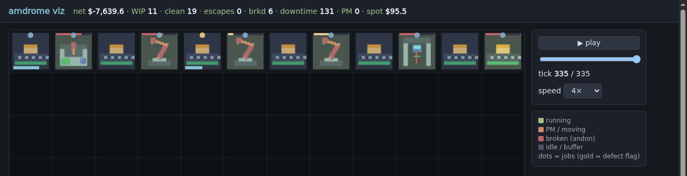
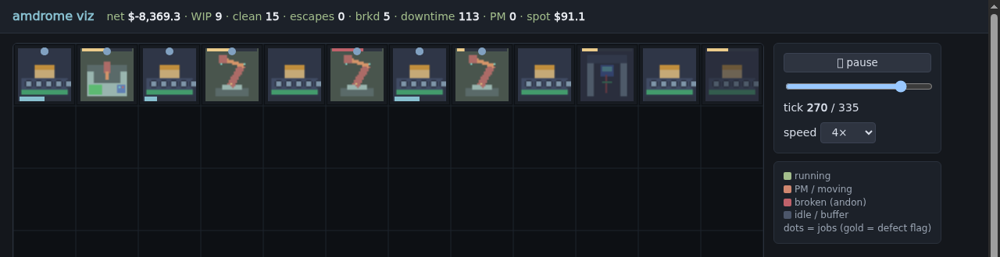

# amdrome

**Intelligent Industry Factory Simulation Engine & Autonomous Agent Benchmark**

`amdrome` is a discrete-event manufacturing simulation: a hands-on tool for
**teaching kanban concepts and reinforcement learning together** — WIP limits,
pull signals, inspection and maintenance scheduling on one side; a
Gymnasium-compatible RL environment with scripted baselines on the other. It
is an open benchmark in the lineage of Kaggle simulation environments
(`kaggriculture`), and the core of our Intelligent Industry hackathon demo.

## Screenshots

The live visualizer (also at <https://alexcasper.github.io/amdrome/>) — the
kanban card stream, station floor with andon alerts, and the KPI HUD:



*End of a blind run-to-failure episode — six breakdowns tripped their red
andon panels; net −$7.6k. The condition-based-PM assistant prevents exactly
this (−73.6% unplanned downtime on held-out seeds).*



*Mid-episode production: stations, buffers and the spot-market/contract HUD.*

---

## How to play

You are the plant manager of a small factory. One episode is one production
week (336 ticks). Your goal: deliver ordered jobs on time, with good quality,
and end the week with more money than you started.

**The loop.** Contracts arrive offering to pay for batches of products.
You bid against rival factories for the ones worth taking. Winning a contract
means buying raw inputs, pushing batches through the line
(cut → form → weld → paint → inspect → pack), and delivering before the
deadline. Miss the deadline or ship defects and you pay penalties.

**What you decide each week:**

- **Bidding** — which contracts to chase, and how aggressively to price.
  Big jobs pay well but crowd out smaller ones.
- **Buying** — raw inputs come from a jumpy spot market or slower lead-time
  orders. Buy ahead and tie up cash, or buy late and risk the line starving.
- **Layout** — stations sit on a grid. Moving a station takes it offline
  (travel distance costs); re-pointing a line to a station that's already
  there is free. Shorter routes mean faster jobs.
- **People** — assign workers with the right skills, cross-train them,
  manage fatigue and absences. Technicians are shared: time spent on
  preventive maintenance is time not spent fixing a broken station.
- **Quality** — inspection is a dial (skip / sample / full). Catch defects
  before the customer, or pay PPM penalties and contract risk.
- **Monitoring** — you never see machine wear directly. You buy information:
  a limited budget of SPC samples per shift, alarms you configure yourself
  (with false positives). What you choose to watch is what you can react to.

**The trap to learn.** Machines wear invisibly until they break. Run to
failure and you lose the line at the worst moment; over-maintain and the
technician is never free. The winning habit — watch cycle times drift,
service before the cliff — is exactly the kanban/SPM discipline the
simulation teaches.

**Try it:**

```bash
python3 bin/run_episode.py --seed 4242 --dump episode.jsonl   # run a week
python3 -m http.server 9122 --directory viz                   # watch it
python3 bin/run_match.py --agents agents/blind.py agents/char_pete.py --seed 4242
```

Or open the live demo: <https://alexcasper.github.io/amdrome/>

---

## Deliverables & Architecture

1. **The Simulation Engine (`amdrome_sim`)**
   * Pure Python + NumPy discrete-event simulation core based on system dynamics (Sterman, *Business Dynamics*).
   * Dual interface: `kaggle_environments` compatible episode runner (JSON observation/action protocol) and Gymnasium / PettingZoo vector environments for RL.
   * **Anti-tape by design**: hierarchical Bayesian hyperpriors and partial observability prevent trajectory memorization while preserving seed-level determinism.

2. **The Sample Agent Ecosystem (`agents/` & `rl/`)**
   * Readable scripted baselines: Blind Run-to-Failure, Lean Kanban Pull, and Adaptive Reactive Heuristics.
   * Parameter tuning pipeline using Bayesian search (Optuna / GEPA).
   * Stable-Baselines3 (MaskablePPO) training pipeline designed for fleet execution.

3. **The Intelligent Industry Demo Product (`demo/`)**
   * Live streaming **Operator Assistant** running over the kanban observation stream.
   * Statistical CUSUM drift detection and Weibull Remaining Useful Life (RUL) estimation.
   * Interactive Rich terminal operator console with real-time floor topology, andon boards, and prescriptive recommendations.
   * Automated paired A/B evaluation suite (`demo/benchmark/`), independently
     verified on held-out seeds: the default Operator Assistant cuts
     **unplanned downtime −73.6%** vs run-to-failure (2000 held-out episodes;
     details in `research/2026-10-17-ab-verification.md` and
     `demo/benchmark_report.md`).

---

## Game Mechanics

### Current (in the engine today)

**World & layout.** Discrete ticks (episode = one production week, 336 ticks).
Grid floor is config-parameterized (`grid_w/grid_h`; default **12×8** —
challenge tier 16×12, cramped tier 8×6); stations (`cut, form, weld, paint,
inspect, pack` + buffers) occupy 1–4-cell footprints. Jobs are batches with
ordered routes, flowing station→buffer→station with distance-based transport
time. Layout is a real decision: physical moves take the station offline
(cost scales with distance); rebinding a line to an already-placed station
is the cheap move. Measured per grid size (400 paired seeds/point, layout
share of cycle-time variance / scenario share / compact-vs-scattered d_z):

| grid | policy share | scenario share | c−s d_z (cycle) |
|---|---|---|---|
| 8×6 | 47% | 38% | 2.49 |
| 12×8 (default) | 64% | 24% | 2.89 |
| 16×12 | 77% | 14% | 3.35 |

Bigger floors amplify layout skill and shrink scenario variance;
transport dominates at every size (blocking never binds with a single
line). Runtime is flat (~40 ms/episode full engine). Details:
`research/2026-10-17-grid-sweep.md`; factory expansion (buy-a-wing)
design at `DESIGN.md` §10.

**Degradation & failure.** Hidden per-station `wear ∈ [0,1]` driven by usage.
Wear inflates cycle time (gradual drift — the signal SPC monitoring can catch),
raises defect probability, and drives a convex breakdown hazard (infant
mortality + wear-out mix). Breakdowns take stations offline until a tech
repairs them; unplanned downtime propagates into WIP pileups.

**Quality & inspection.** Defects injected per operation (base rate × wear ×
skill); flow downstream to `inspect` stations or escape to the customer (PPM
penalty, contract risk). Inspection modes (skip / sample / full) set the
catch probability — and their economics are a live balance question (see
known issues).

**Labour.** Rostered workers with per-station-type skill vectors, fatigue
accumulation (error/injury multipliers), and random absences. Shared tech pool
contends between preventive maintenance and repairs. Actions: assignment,
cross-training, shift swaps, PM scheduling, worker-affinity matching.

**Monitoring (the skill surface).** The agent sees only the kanban layer:
coarse station cards every K ticks, cycle-time SPC samples *where it allocated
the limited sampling budget*, buffer pull signals at card granularity,
inspection counts, and alarms it configured — with false-positive rates that
make alarm tuning a real tradeoff. Measured: raising the sampling budget from
4→16 probes/shift cuts drift-detection latency 31% and missed breakdowns 47%.

**Market & procurement.** Stochastic contract arrivals (size, price, deadline,
quality floor, penalty) with sealed first-price bidding; mean-reverting jump
spot market; raw inputs at volatile prices with lead times — buy-ahead
inventory policy is a scored decision surface.

**Economics.** Calibrated costs with station-asymmetric wear ("prevention
pays, monitoring matters"). Score = delivered profit − penalties − scrap −
energy, plus KPI league points (ontime%, PPM, downtime%).

**Anti-tape RNG.** Every stochastic element (12-item inventory: arrivals,
prices, wear, breakdowns, cycle times, defects, escapes, absences, fatigue,
repairs, transport, bid opponents) is drawn from per-episode hyperprior
parameters — episodes differ structurally, so trajectory memorization fails
while seed-level determinism holds (sha256-derived seeds, per-episode
generators).

### Planned (spec'd or beaded — not landed)

- **Product catalog — per-item manufacturing chains**: jobs reference a product
  with its own route (stages may be skipped or revisited), price, quality floor,
  and penalty profile. Contracts arrive per product with hyperprior-drawn
  arrival rates, so the product *mix* varies per episode (anti-tape lever);
  bidding becomes a mix-selection decision that interacts with layout
  (route length × transport) and labour (per-product skill demands).
  v1 scope: 3 products; BOM trees / multi-level assembly deferred to v2.
- **Configurable grid size + balance sweep**: grid dimensions move to config
  (8×6 / 12×8 / 16×12 being swept) — measuring layout-vs-scenario-vs-noise
  variance split, runtime, and blocking/transport behaviour per size, so the
  default is chosen from data rather than assertion.
- **Factory expansion (rent)**: players start on a base plot and buy adjacent
  expansion wings (farm buy-a-quadrant style). Rent is a running cost —
  expansion must pay for itself through throughput and layout freedom. The
  wing-pricing curve is derived from the size-sweep balance data; designed to
  interact with product mix (long routes justify bigger floors) and labour
  (more stations, more workers/techs). Implementation lands after the sweep,
  behind a config flag, with its own A/B.
- **RL training harness** (amdrome-x4i, in progress): knob-search +
  Stable-Baselines3 MaskablePPO fleet runs against the Gym core.
- **RL-tuned sample agent** (amdrome-u2e): readable baseline, tuned by RL.
- **Engine fixes from A/B verification**: understaffing no longer *speeds*
  stations up (staffing multiplier fixed, amdrome-svf, golden v8); full
  inspection is still free, dominating the escape metric (amdrome-hpm, open).
- **Multi-factory shared-market self-play**: bidding opponents drawn from a
  policy pool; league/match runner with the acceptance gates (anti-tape +
  skill-dominance tests) from DESIGN.md §Acceptance.
- **`kaggle_environments` submission runner**: single-file agent submissions,
  per-turn timeout, episode replays.
- **Graphical floor view**: v1 sprite pack committed (`assets/sprites/`,
  9 sprites + regenerable PIL source); animations and an Aseprite-MCP
  authoring pass planned.
- Deliberately cut from v1: AGV/forklift pool (documented in DESIGN.md —
  score-weighting achieves the same skill surface cheaper).

---

## Documentation Suite

Detailed architecture, mathematical models, API contracts, and roadmap specifications:

* 📄 **[Master Comprehensive Plan](docs/COMPREHENSIVE_PLAN.md):** Overall system blueprint, strategic lessons from kaggriculture, acceptance gates, and delivery plan.
* 📐 **[Simulation Mechanics Specification](docs/SPEC_MECHANICS.md):** Mathematical models of world topology, stock-flow queues, wear degradation, defect cascades, labour fatigue, market bidding, and two-tier RNG inventory.
* 🔌 **[API & Environment Specification](docs/SPEC_API_ENV.md):** `kaggle_environments` JSON schema, Gymnasium `FactoryGymEnv` interface, PettingZoo multi-agent interface, and headless runner CLI (`bin/run_match.py`).
* 🖥️ **[Demo Product Specification](docs/SPEC_DEMO_PRODUCT.md):** Operator Assistant analytical architecture, terminal UI layout, paired A/B benchmark methodology, and 3-minute pitch script.
* 🗺️ **[Roadmap & Beads Breakdown](docs/ROADMAP_AND_BEADS.md):** Phased project roadmap, Beads task hierarchy, and execution protocol.
* 📜 **[Project Charter](CHARTER.md):** Ratified charter, hackathon brief, and anti-tape design goals.
* 🛠️ **[Design v0 Workbench](DESIGN.md):** Working design document and initial layout prototype findings.

---

## How it's built

Developed by a fleet of AI agents (GLM / Claude / Gemini panes) under a
coordinator, with every benchmark number produced by scripted, reproducible
runs — the repo's `research/` directory holds the verification artifacts.

## Acknowledgements

- **AMD AUP academic programme** — RL training and testing for this project
  ran on an **AMD Radeon AI PRO R9700** (gfx1201) via ROCm, provisioned
  through the AUP cloud: Stable-Baselines3 MaskablePPO trained 20,480 steps
  (90 gradient updates, ~423 steps/s) on PyTorch 2.9.1 + ROCm 7.13 (HIP),
  unmodified — see `docs/assets/aup_gpu_evidence.log`.
- The simulation engine itself is pure Python and CPU-only — the benchmark
  runs anywhere; the RL pipeline is what runs on AMD.

---

*Built for the [AMD Developer Hackathon: ACT III](https://lablab.ai/ai-hackathons/amd-developer-hackathon-act-iii).*

