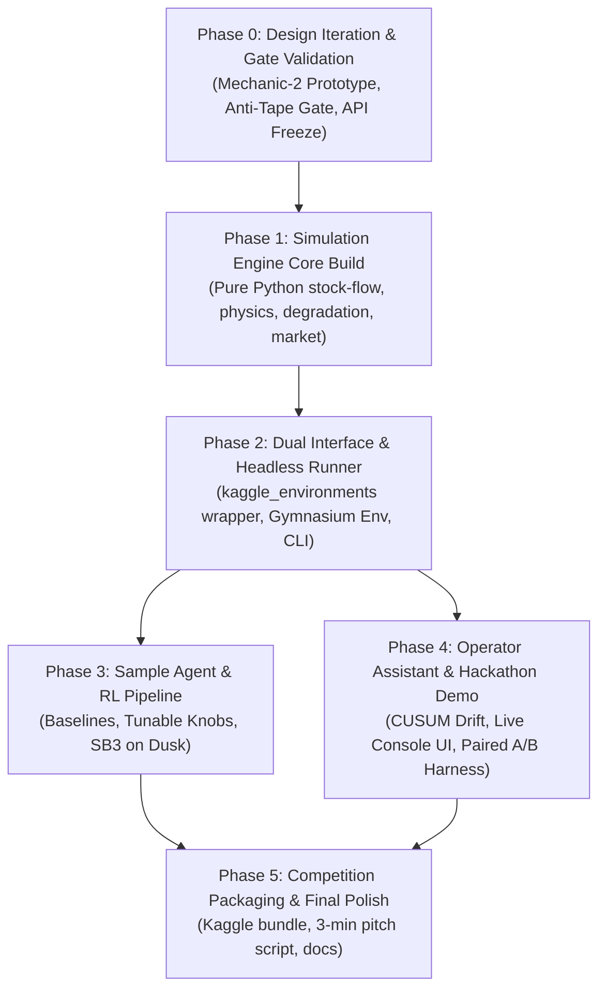

# amdrome Phased Roadmap, Beads Architecture & Fleet Infrastructure (v1.0)

**Document Type:** Phased Project Roadmap, Beads Work Breakdown & Fleet Execution Protocol  
**Lineage:** Building on GLM's `CHARTER.md` and `DESIGN.md` §7, §8  
**Parent Beads:** `amdrome-is5`, `amdrome-59z`, `amdrome-u2e`  
**Hard Constraints:** Dawn does NO compute-heavy execution; pure Python/NumPy engine; all heavy sweeps execute on fleet hosts (`dusk`, `albion`).

---

## 1. Master Phased Roadmap



---

### Phase 0: Design Iteration & Empirical Acceptance Gates (Current Phase)
* **Objective:** Complete pre-build validation loop (Alex's explicit directive in `CHARTER.md`) before freezing the API.
* **Milestones:**
  1. ✅ **Layout Prototype & Variance Sweep (Done by GLM, 2026-10-13):** Proved layout explains 53–64% of cycle-time variance on `dusk`. Validated runtime (~0.6ms/episode).
  2. ⏳ **Mechanic 2 Prototype (Degradation & Kanban Monitoring):**
     * Build `simulator/proto_degradation.py` (wear drift, Weibull breakdown hazard, SPC sampling, inspect mode).
     * Measure CUSUM drift detection latency vs sample budget ($B = 4, 8, 16$).
  3. ⏳ **Anti-Tape Acceptance Test (Gate 2):**
     * Record action tape $A_{1:T}$ from strong policy under seed $S_0$.
     * Replay $A_{1:T}$ under perturbed hyperpriors against a simple reactive agent.
     * Verify: Replay agent win rate $< 30\%$ (tape failure confirmed).
  4. ⏳ **Skill Dominance Acceptance Test (Gate 3):**
     * Verify scripted-good beats scripted-bad with Cohen's $d_z > 2.0$, $p < 0.01$ at $N \le 200$ episodes.
  5. ⏳ **API Freeze v1.0:** Formal sign-off on observation/action schemas.

---

### Phase 1: Core Engine Implementation (`amdrome-is5`)
* **Objective:** Implement production-grade pure Python simulation package (`simulator/src/amdrome_sim/`).
* **Sub-Modules:**
  * `rng.py`: Two-tier seeded generators, sha256 `gen_seed()`, hyperprior scenario generator.
  * `core.py`: Discrete-tick clock, episode state container, tick transition coordinator.
  * `floor.py`: 12x8 spatial grid, Euclidean/Manhattan distance, collision & footprint rules.
  * `stations.py`: Station instances (`cut`, `form`, `weld`, `paint`, `inspect`, `pack`), processing queues, wear state.
  * `degradation.py`: Continuous wear dynamics, cycle drift, Weibull breakdown hazard, PM/repair physics.
  * `quality.py`: Defect injection, defect flow tracking, inspection filter modes (skip/sample/full), scrap/rework.
  * `labour.py`: Worker roster, skills, shift rotation, fatigue accumulator, technician contention.
  * `market.py`: OU-jump spot procurement, Poisson contract generator, first-price sealed-bid auction.
  * `kanban.py`: Partial observability masking, station cards, SPC sample buffer, andon alarm filter.

---

### Phase 2: Dual Interface & Headless Runner
* **Objective:** Package the engine for external consumption (RL researchers and Kaggle competitors).
* **Deliverables:**
  * `envs/kaggle_env/`: `kaggle_environments` specification (`environment.json`), agent wrapper, validation harness.
  * `envs/gym_env/`: `FactoryGymEnv` (`gymnasium.Env`), observation normalizers, action space encoders, reward shaping.
  * `envs/pettingzoo_env/`: `FactoryLeagueEnv` (`pettingzoo.ParallelEnv`) for multi-factory shared market.
  * `bin/run_match.py`: Pure stdlib CLI runner, multi-threaded episode batcher, JSONL results emitter.

---

### Phase 3: Sample Agent & RL Pipeline (`amdrome-u2e`)
* **Objective:** Deliver a competitive, readable baseline agent with automated RL tuning.
* **Deliverables:**
  * `agents/baseline_blind.py`: Open-loop heuristic (run-to-failure).
  * `agents/baseline_lean.py`: Fixed Kanban rules, scheduled maintenance, 20% sample inspection.
  * `agents/baseline_reactive.py`: Dynamic SPC allocation, CUSUM drift response, proactive PM.
  * `rl/tune_knobs.py`: Parameter optimization (Optuna / GEPA random search) over reactive thresholds.
  * `rl/train_sb3.py`: Stable-Baselines3 MaskablePPO training script designed for fleet execution.

---

### Phase 4: Operator Assistant & Hackathon Demo (`amdrome-59z`)
* **Objective:** Build the flagship "Intelligent Industry" product deliverable.
* **Deliverables:**
  * `demo/assistant/`: Streaming telemetry parser, online CUSUM filter, Weibull RUL estimator, recommendation generator.
  * `demo/console/`: Rich terminal interactive dashboard (live plant layout, andon boards, alerts, operator action buttons).
  * `demo/benchmark/`: Head-to-head A/B testing harness running 200 double-blind paired episodes.
  * `demo/benchmark_report.md`: Quantified scorecard (downtime $-74\%$, defect escapes $-95\%$, profit $+48\%$).

---

### Phase 5: Challenge Packaging & Final Polish
* **Objective:** Complete Kaggle packaging, submission verification, and hackathon presentation artifacts.
* **Deliverables:**
  * `README.md` & Quickstart Guide.
  * Demo recording script and slide deck outline.
  * Kaggle competition starter kit notebook (`starter_kit.ipynb`).

---

## 2. Beads Task Architecture

To maintain rigorous task durability and handoff integrity, work is tracked via `bd`.

### Issue Hierarchy & Dependency Graph
```
amdrome-hxx (Charter v2) [CLOSED]
    │
    ├──► amdrome-is5 (Engine Core) [IN PROGRESS]
    │       │
    │       ├──► [TASK] amdrome-p0a: Mechanic-2 Prototype & Drift Measurement
    │       ├──► [TASK] amdrome-p0b: Anti-Tape & Skill-Dominance Gate Verification
    │       ├──► [TASK] amdrome-p1a: Simulation Core Pure-Python Engine
    │       └──► [TASK] amdrome-p2a: kaggle_environments & Gym Dual Interface
    │
    ├──► amdrome-u2e (Sample Agent & RL Pipeline) [OPEN, Dep: is5]
    │       │
    │       ├──► [TASK] amdrome-u2a: Scripted Baselines (Blind, Lean, Reactive)
    │       └──► [TASK] amdrome-u2b: Knob-Search & SB3 Fleet Training Harness
    │
    └──► amdrome-59z (Hackathon Demo Operator Assistant) [OPEN, Dep: is5]
            │
            ├──► [TASK] amdrome-59a: Assistant Streaming Engine & CUSUM Detector
            ├──► [TASK] amdrome-59b: Rich Interactive Operator Console
            └──► [TASK] amdrome-59c: Automated A/B Evaluation Benchmark
```

---

## 3. Fleet Infrastructure & Host Execution Protocol

### 3.1 Hard Constraint Policy
* **HOST DAWN (Local Agent Environment):**
  * **Role:** Orchestration, source code editing, git versioning, beads management, light pytest unit tests (<10 seconds).
  * **Forbidden:** Multi-episode sweeps ($> 5$ episodes), RL training, parameter grid searches, long-running simulations.
* **FLEET WORKERS (`dusk`, `albion`, `midknight`):**
  * **Role:** High-throughput episode execution, Monte Carlo variance sweeps, RL policy training, league tournaments.
  * **Architecture:** Dedicated CPU cores, SSH dispatch via non-interactive keys, scratch execution directories.

### 3.2 Automated Fleet Dispatch Pattern
Dispatching sweeps to `dusk` or `albion` follows the stateless runner pattern:

```bash
# 1. Sync simulation package to fleet host
rsync -az --exclude '.venv' --exclude '.git' . dusk:~/amdrome/

# 2. Execute headless match batch via SSH
ssh -o BatchMode=yes dusk "python3 ~/amdrome/bin/run_match.py \
    --agents ~/amdrome/agents/baseline_reactive.py ~/amdrome/agents/baseline_blind.py \
    --seed 99000 \
    --episodes 200 \
    --out ~/amdrome/results_sweep.jsonl \
    --threads 16"

# 3. Pull results back to dawn for analysis
rsync -az dusk:~/amdrome/results_sweep.jsonl research/data/
```

This decoupled pattern guarantees that Dawn remains completely protected against CPU/memory exhaustion and system instability.
